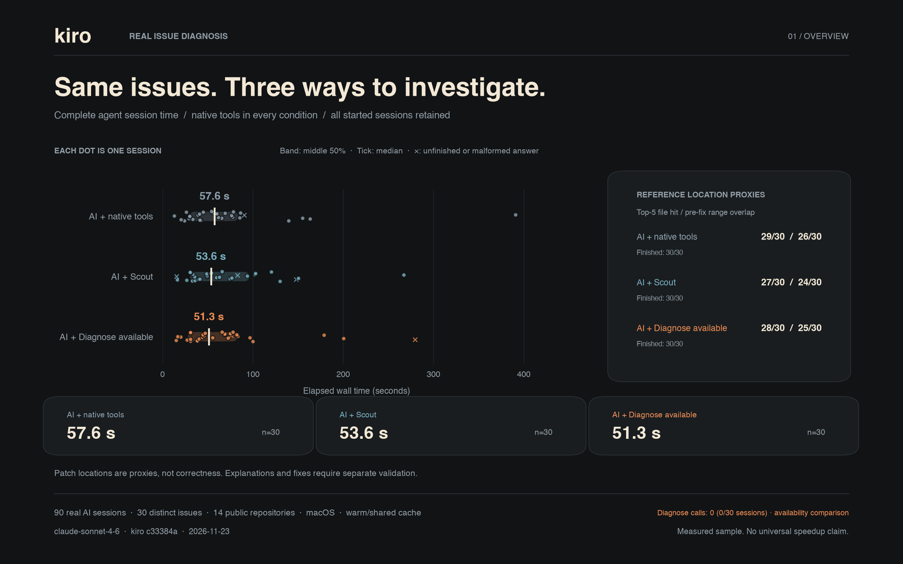
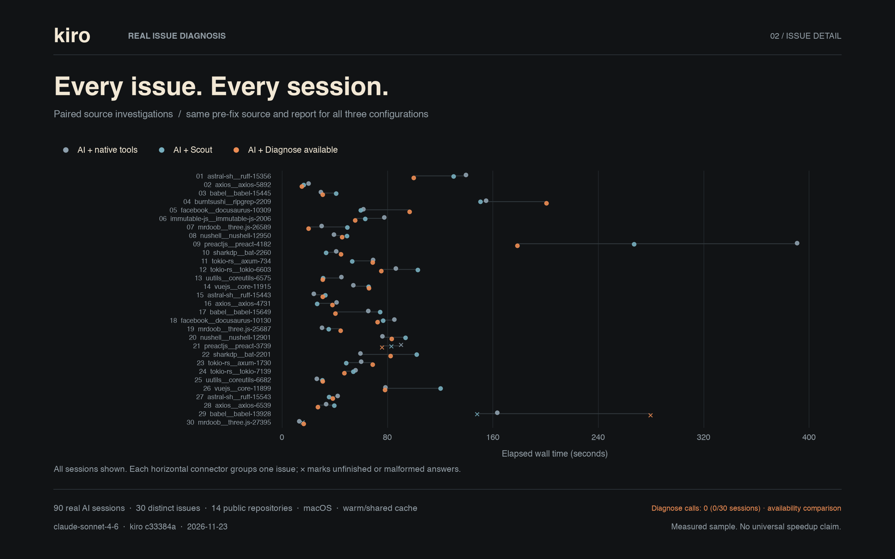
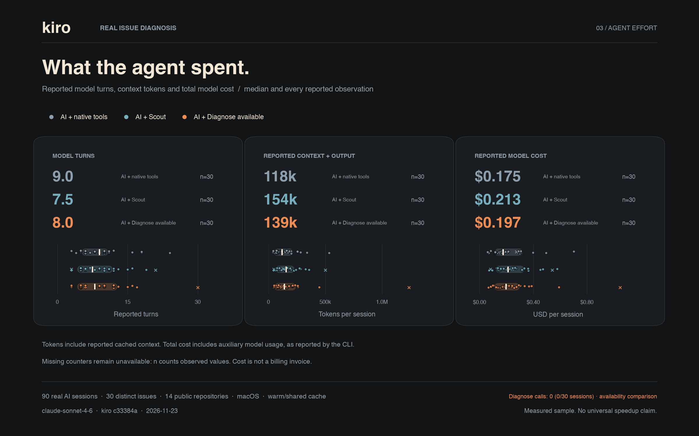
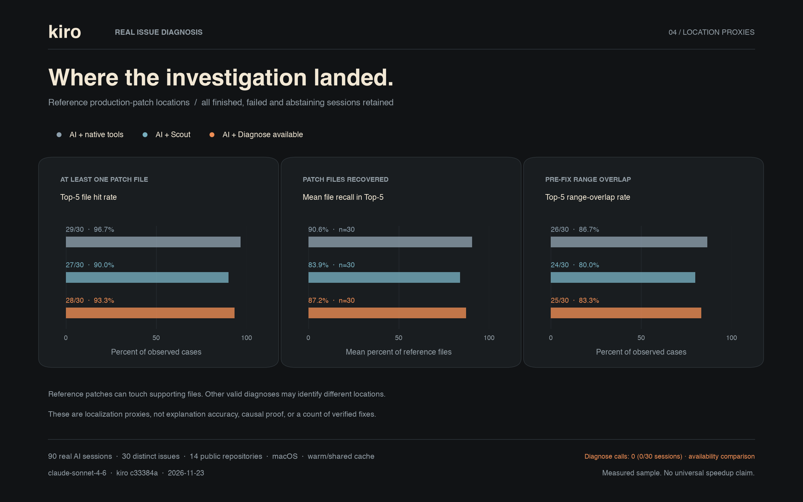

# kiro

**A terminal engine for AI coding agents: same commands, no shell, fewer round trips.**

[](https://github.com/nicolashedoire/kiro/actions/workflows/ci.yml)

> Status: experimental. macOS only for now. Compatibility is checked against the system
> tools, but a passing corpus is not a guarantee for every shell expression. Read the
> [limits](#limits) before relying on it.
>
> Not affiliated with [Kiro](https://kiro.dev), the IDE from AWS.

## Why

When an AI agent reads one file through a terminal, the command travels through a chain: the
harness reviews it, hooks run, a fresh shell starts and loads its profile, wrappers start, and
only then does the real program run. On top of that, **every tool call is a full round trip
with the model that re-reads the whole conversation**. An agent that explores a code base one
`grep` at a time pays that price a dozen times before it changes a single line.

The idea comes from container engines such as [Kiri](https://github.com/libracoder/kiri): keep
the interface people already use, and replace the chain behind it. kiro keeps the commands the
agent already writes (`grep`, `sed -n`, `cat`, …) and removes what sits behind them.

## What it does

- **`run`: a read-only terminal with no shell.** `cat`, `sed -n`, `head`, `tail`, `wc`, `cut`,
  `ls`, `grep`, pipelines and `;` / `&&` / `||` lists run inside one long-lived process. No
  shell or program is started for supported forms. Differential tests check the output
  against the system tools.
  Several commands fit in one call, so one round trip brings back several answers.
- **`scout`: the map of an area of the code in one call.** Give it the words you care about;
  it returns the files that mention them, ranked, with matching lines and declaration
  context. Tree-sitter identifies functions, methods, classes and types in Rust,
  JavaScript/JSX and TypeScript/TSX, including multiline signatures and configuration
  bindings. Other files keep an
  explicitly marked lexical heuristic. Structured results include exact source ranges.
- **`diagnose`: an experimental local investigation pipeline.** Supply an error, stack
  trace or issue description. It extracts terms and source anchors, searches with Scout,
  combines retrieval signals and reads bounded source excerpts in one call. It returns
  evidence and explicit limits, without running a model or project code. A ranking is not
  a proven cause or a validated fix. See [usage and limits](docs/diagnose.md).
- **An MCP server** that gives these tools to an agent such as Claude Code.

Three rules hold it together:

1. **Same commands.** The agent has nothing to learn.
2. **Same results, or no result.** A command is either run entirely inside the engine or not
   at all. Anything not covered is refused (MCP) or handed to your regular shell (CLI), never
   approximated. A [differential test suite](tests/differential.rs) compares the engine with
   the system tools, byte for byte.
3. **Designed for reading.** Native `run` executes fixed built-ins without starting a
   program. `scout` invokes system Git to discover files, with hooks and filesystem-monitor
   commands disabled, then reads the files. These tools do not provide an OS sandbox or
   restrict access to the project directory; normal filesystem permissions still apply.

## Results

**90 real AI sessions, 30 public issues, 14 repositories, 23 November 2026.**
Kiro source `c33384a`; Claude Sonnet 4.6, one session per case/configuration. Every
configuration includes native Bash, Read, Grep and Glob; scripts and batching are allowed.
Scout adds MCP run/scout. The third configuration also makes diagnose available.

**Diagnose was called in 0/30 measured sessions where it was available.** The figures compare
available configurations; they do not measure a benefit from the unused new pipeline.



| Configuration | Median session time | Median model turns | Total reported cost (30 sessions) |
| --- | ---: | ---: | ---: |
| AI + native tools | 57.6 s | 9 | $6.62 |
| AI + Scout | 53.6 s | 7.5 | $7.28 |
| AI + Diagnose available | 51.3 s | 8 | $7.20 |

Comparing each issue to itself, the median time ratio was **0.971 with Scout and 0.995 with
Diagnose available**: 2.9% and 0.5% less time in this sample. Both were faster on 16/30 cases.
These paired observations differ from the ratio of overall medians shown above; neither
is a causal or universal speedup claim. Total model cost increased by 10.0% and 8.7%.

All 90 sessions finished; 29/30, 27/30 and 28/30 answers were parseable respectively.
Those same counts hit a reference file in Top-5, but patch overlap is not explanation
correctness. A separate source-based AI review labeled 27/30, 26/30 and 26/30 explanations
supported, with material errors in the others. These qualitative labels are not human
certification, and no external project tests or fixes were validated. **This campaign does
not establish a compelling practical advantage over native tools.**

<details>
<summary>See all issues, model effort and location proxies</summary>







</details>

[Method, frozen inputs, all answers, review, data and reproduction scripts](docs/benchmarks/2026-11-23-diagnose/README.md).
The previous [30-session Scout comparison](docs/benchmarks/2026-11-23-sonnet46/README.md)
and [21 November campaign](docs/benchmarks/2026-11-21-sonnet46/README.md) remain separate
archives. Their protocols differ and do not isolate a version-to-version improvement.

The repository includes differential tests and a public, temporary benchmark fixture:

```sh
cargo run --release --locked --example replay -- --fixture
```

This checks native stdout, stderr and exit status against `/bin/sh` and the macOS tools,
without private sessions or model calls. The optional MCP mode compares formatted UTF-8
responses, not raw binary streams. It is a small reproducible check, not a representative
performance study.

Earlier measurements on one private TypeScript monorepo suggested fewer model round trips
and lower latency. They predate the audit fixes, have not been revalidated, and do not
establish the performance or accuracy of the current version. The historical results,
method, limitations and reproduction commands are in [docs/benchmarks.md](docs/benchmarks.md).

## Install

Requires Rust **1.90 or newer** ([rustup.rs](https://rustup.rs)) and a C compiler for the
bundled Tree-sitter grammars (the macOS Command Line Tools provide one).

```sh
cargo install --git https://github.com/nicolashedoire/kiro
```

Or from a clone:

```sh
git clone https://github.com/nicolashedoire/kiro
cd kiro
cargo build --release      # the binary is target/release/kiro
```

## Use

### From the command line

```sh
$ kiro run --stats "grep -rn 'export function' src | head -3"
src/api.ts:12:export function load(id: number) {
src/api.ts:40:export function save(item: Item) {
src/store.ts:8:export function createStore() {
[kiro] inside the engine, 0 program started, 0.41 ms

$ kiro run --stats "ls -la"
…
[kiro] handed to the regular shell (ls -l), 2 programs started, 9.80 ms

$ kiro scout "retry" "max attempts" "backoff"
SCOUT - 7 files mention these terms (412 text files read; 3 skipped; 0 read errors)
…

$ kiro diagnose --report /path/to/failing-test.log
…
```

`--stats` tells whether the command ran inside the engine and how long it took.

### With Claude Code

In the project where you want it:

```sh
claude mcp add kiro -- kiro mcp
```

To let the agent call it without a prompt each time, allow the read-only tools in your
Claude Code settings:

```json
{ "permissions": { "allow": ["mcp__kiro__run", "mcp__kiro__scout", "mcp__kiro__diagnose"] } }
```

Remove it with `claude mcp remove kiro`. Any other MCP client works the same way: the server
speaks JSON-RPC over standard input and output (`kiro mcp --project DIR`).
Use `kiro mcp --tools run,scout` to expose only those two tools; disabled tools cannot be called.

### What the agent sees

```jsonc
// one call…
{ "name": "run", "arguments": { "commands": [
    "grep -n 'export function' src/api.ts",
    "sed -n '12,30p' src/api.ts",
    "wc -l src/*.ts"            // not covered (glob): refused, nothing is executed
] } }
```

```text
$ grep -n 'export function' src/api.ts
12:export function load(id: number) {
40:export function save(item: Item) {
$ sed -n '12,30p' src/api.ts
…
$ wc -l src/*.ts
[not run: the fast terminal does not cover this (unquoted glob). Use the regular shell for it.]
```

## What the engine covers

| Command | Forms |
| --- | --- |
| `cat` | `cat [-n] FILE...` |
| `sed` | `sed -n 'A,Bp'`, `'Np'`, `'A,$p'`, several ranges separated by `;` |
| `head`, `tail` | `-N`, `-n N`, `tail -n +N` |
| `wc` | `-l`, `-w`, `-c` and the default |
| `cut` | `-c LIST`, `-b LIST`, `-d X -f LIST`, `-s` |
| `ls` | plain names, `-1`, `-a`, `-A` |
| `echo` | plain words |
| `grep` | `-r -n -i -v -w -x -c -l -L -o -q -s -H -h -I -a -E -F -e -m -A -B -C`, `--include`, `--exclude`, `--exclude-dir` |
| `cd` | remembered for the rest of the session |
| Pipelines and lists | `a | b`, `a && b`, `a || b`, `a ; b`, `2>&1`, `2>/dev/null` |

Everything else is left to your shell: globs, variables, substitutions, redirections to a
file, background jobs, and any program not in this table. See
[docs/architecture.md](docs/architecture.md) for the reasons.

The table describes command families, not every combination of their arguments. In
particular, `grep -w` accepts only literal ASCII words (letters, digits and `_`), `grep -o`
refuses alternative patterns (including several `-e` patterns), and `--color=always` is
refused. Recursive grep paths ending in `/` are refused because macOS versions disagree on
their printed spelling. Use `src` instead of `src/`. Explicit program paths such as
`/custom/cat`, shell special parameters (`$$`, `$?`, etc.), multiple redirections, and
`2>&1` combining both output and errors are also left to the shell.

Shell comments are recognized outside quotes; quoted/escaped `#` stays literal. Lists
and pipelines are checked before any branch runs, including branches skipped by `&&` or
`||`. `cd` keeps logical navigation through symlinks, including across calls. Its options,
`CDPATH`-dependent destinations and lookup failures are left to the shell.

Locale-sensitive cases are deliberately restricted: native `wc -w` and default `wc`
require ASCII input (`wc -l` and `wc -c` still accept other bytes). Native grep refuses
directional word anchors and alphabetic backslash extensions such as `\<`, `\>`, `\A`,
`\b` and `\w`. Case/word matching and bracket expressions on non-ASCII or NUL-containing data can be
refused when equivalence with the BSD locale rules is not established. Literal Unicode
searches remain available. `grep -m 0` and negated filename classes are also refused.
Filename filters use an iterative matcher with a shared work budget instead of recursive
backtracking; exhausting that budget returns a refusal.

The MCP tools also return **versioned structured results**, alongside the readable text.
`run` keeps stdout, stderr and exit codes separate for each command, and reports refusals
inside batches. Search records come directly from grep, with paths, line numbers and byte
offsets into the original stdout. `scout` exposes completion status, scan counts and direct
match references even when its text budget is zero. Each tool advertises an `outputSchema`.
See the [structured result contract and examples](docs/structured-results.md).
Scout's schema version is now **2**, adding deduplicated per-file syntax information;
`run` keeps schema version 1; `diagnose` starts at version 1.
`diagnose` adds ranked candidates, ranking signals and bounded source excerpts;
completion describes the selected search, not a proven root cause.
Readable Scout answers reserve paths and short previews before expanding signatures.
Anonymous callbacks keep a useful named parent in view; missing declarations can use an
explicit lexical heuristic, while ambiguous declarations never acquire a guessed parent.

## Limits

- **macOS only.** The engine reproduces the BSD tools that ship with macOS. On Linux the GNU
  tools format some outputs differently; that port is not done.
- **Search and read only.** kiro does nothing for the commands that take most of the wall
  time in real sessions: tests, type-checks, builds.
- **Bounded native reads.** Only regular files up to 8 MiB are read; devices, FIFOs and
  larger files are refused before reading. Each stage accepts at most 16 MiB of file input,
  and each output/error buffer is capped at 2 MiB. Oversized native results are refused,
  never silently truncated. CLI fallback runs the original command in the regular shell;
  these bounds do not apply to that shell.
- **Bounded MCP requests.** At most 128 commands per call, 64 KiB per command and 2 MiB of
  combined response text. An input message over 1 MiB is rejected and the server exits.
  Non-UTF-8 output is refused; `exact: true` disables grouping but errors and exit codes
  remain formatted in the readable text. Structured stdout/stderr are always separate and
  ungrouped. Encoded text plus structured data are limited to 8 MiB, checked while a batch
  accumulates; exceeding a response bound rolls back the call's directory changes.
- **Bounded scout.** At most 10,000 candidate files, 16 MiB of input and 16 MiB of retained
  content; files over 400,000 bytes are skipped. Answers are capped at 64 KiB of UTF-8 text,
  including notices for partial scans or truncated output. Repository `.gitignore` and
  `.git/info/exclude` apply; global Git ignore settings are deliberately not loaded.
  Unreadable candidates are reported separately from documented exclusions, and are not
  counted as successfully read. An incomplete scan returns CLI exit status 1 or MCP
  `isError: true`, while retaining any partial answer. This status is preserved even with
  a zero-sized answer budget. Long-line previews show a match window and mark omissions.
  Grep metadata is capped at 4,096 records and 256 KiB. Scout shares 256 KiB between match
  references and syntax evidence, with at most 4,096 references and 256 structure entries;
  omissions are explicitly flagged. Syntax work is separately bounded to 256 matching
  supported files, 4 MiB of source, two seconds of cooperative analysis time and 2 MiB of
  retained scopes per call. Reaching a syntax limit preserves the lexical results.
- **Bounded diagnose.** Reports are limited to 64 KiB, retained candidates to 256 and selected
  files to 16. Encoded structured evidence is capped at 256 KiB after JSON escaping.
  It shares Scout's source exclusions and reports selection, metadata and excerpt omissions
  explicitly. See [the contract and resource limits](docs/diagnose.md).
- **Limited evidence.** The current live comparison uses 30 public issues from 14 repositories,
  one primary model and one session per case/configuration. All configurations include native
  Bash, Read, Grep and Glob. Source projections omit separate tests and dependencies; no
  external project tests or repairs are validated. No universal speed or quality gain is established.
- **A text search.** `scout` finds words. Code that does the same thing without the words is
  not listed. Syntax ranges describe declarations, not resolved symbol references or a
  semantic call graph. Partial, unsupported, non-UTF-8 and limited analyses use an explicit
  heuristic fallback. The current AI-session experiment includes Tree-sitter, but compares
  complete tool configurations rather than isolating the parser's contribution.
- **Coverage.** The supported subset is deliberately conservative. Other commands still
  need the regular shell; historical coverage figures do not describe the current version.

## Development

```sh
cargo fmt --check
cargo clippy --all-targets -- -D warnings
cargo test --locked --all-targets            # unit, differential and benchmark tests
python3 docs/benchmarks/2026-11-23-diagnose/verify_helpers.py  # no model calls
cargo run --release --locked --example replay -- --fixture
```

Differential matrices cover file boundaries, line endings, C/UTF-8 locales, regex/options,
filename filters, comments, conditional lists and logical directory traversal. Supported
cases must execute natively and match stdout, stderr and exit status; expected refusals
are counted separately, so shell fallback cannot disguise a compatibility failure.

The layout and the design rules are described in [docs/architecture.md](docs/architecture.md).

## License

Licensed under either of [Apache License, Version 2.0](LICENSE-APACHE) or
[MIT license](LICENSE-MIT), at your option.
