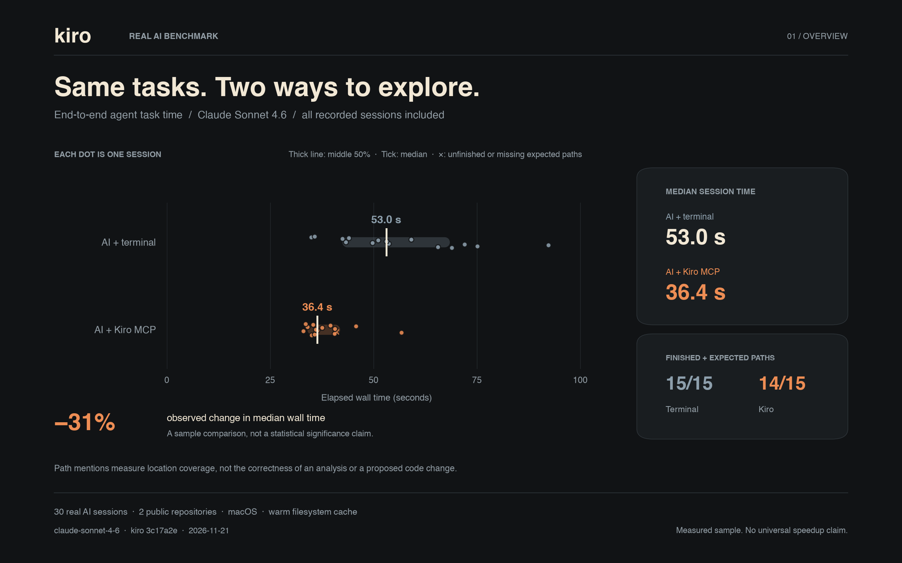
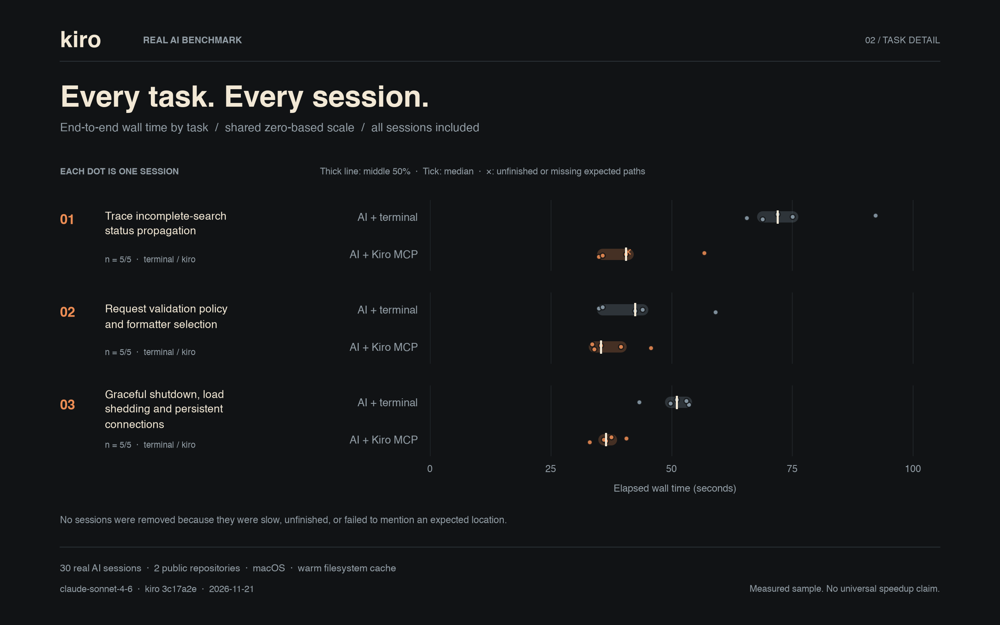
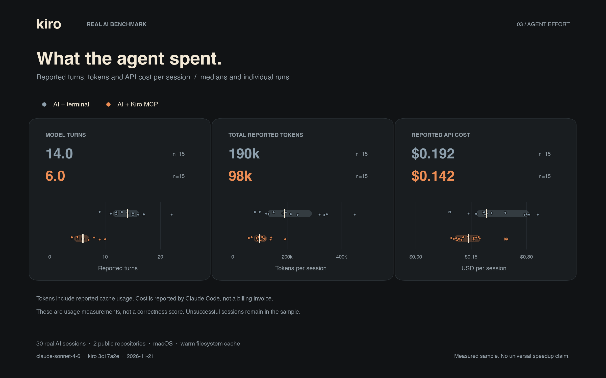

# Real AI sessions — 21 November 2026

This is an exploratory comparison of **30 complete Claude Code sessions**, not a timing
of commands standing in for an AI task. The tested Kiro source is
[`3c17a2e`](https://github.com/nicolashedoire/kiro/commit/3c17a2ec4aa568e2e46ad636b06ee5381e00ee48).
Both conditions use `claude-sonnet-4-6`, effort `medium`, and Claude Code `2.1.173` on macOS.



## Observed results

| Across 15 sessions per condition | AI + system terminal | AI + Kiro MCP |
| --- | ---: | ---: |
| Median elapsed wall time | 53.05 s | 36.39 s |
| Mean elapsed wall time | 56.05 s | 38.71 s |
| Median model turns reported by Claude Code | 14 | 6 |
| Median tokens, including reported cache usage | 190,405 | 98,201 |
| Median model cost reported by Claude Code | $0.1920 | $0.1417 |
| Finished sessions | 15 / 15 | 15 / 15 |
| Finished with all required production paths returned | 15 / 15 | 14 / 15 |

The observed change in overall median wall time is **−31.4%**. This is a sample comparison,
not a significance claim, a universal speedup or a correctness guarantee. Every session is
included in the timings, including the Kiro session that missed a required location.
Reported model cost is not a billing invoice; subscription accounting may differ.



| Task | Terminal median | Kiro median | Required paths found, terminal / Kiro |
| --- | ---: | ---: | ---: |
| Kiro incomplete-search status propagation | 71.98 s | 40.57 s | 5/5 / 4/5 |
| Fastify request validation and formatter selection | 42.44 s | 35.35 s | 5/5 / 5/5 |
| Fastify graceful shutdown and connection draining | 51.10 s | 36.39 s | 5/5 / 5/5 |



## What was held constant

- Three source-investigation tasks, five fresh sessions per task and condition.
- The same user prompt and model in both conditions. Both prompts encourage batching
  independent reads/searches. No builds, tests, installations, edits or other agents are requested.
- **Terminal:** Claude Code's `Bash` tool only, executing real system commands.
- **Kiro:** the same `Bash` tool plus Kiro's `run` and `scout` MCP tools. Shell fallback is
  allowed. Kiro's tool descriptions/server instructions are part of this configuration.
- Other built-in reading/search tools, slash commands, Chrome integration and unrelated
  MCP servers are disabled. `--setting-sources ''` avoids user/project settings sources.
- Each conversation starts fresh, with `--no-session-persistence`. Provider prompt caching
  is not disabled. Filesystem caches are warm/shared.
- Setup order is counterbalanced across repetitions; task order is shuffled deterministically.
  Up to four sessions run concurrently, with both conditions represented.
- A macOS `sandbox-exec` profile denies writes to each source checkout. File hashes before
  and after the benchmark confirm that the datasets were unchanged. This restriction is
  on the tested project tree, not a claim that the entire machine is read-only.
- The primary timing is monotonic elapsed wall time around the full CLI process. It includes
  process/MCP startup, model requests, tool execution and final output. The CLI's separately
  reported duration is also retained in the data.

Two preliminary tool-check sessions and one authentication smoke call were excluded **before**
starting this fixed 30-session experiment. No measured session was removed or rerun to improve
the results. Each measured session had a $3 reported-cost ceiling and a 480-second timeout;
none reached either limit. All 30 reported the same pinned model identifier.

## Public datasets and tasks

- **Kiro:** source archive of `3c17a2ec4aa568e2e46ad636b06ee5381e00ee48`, excluding `.git`
  and build artifacts. This small self-test is shown separately from Fastify.
- **Fastify:** [`6de5abe`](https://github.com/fastify/fastify/commit/6de5abedb24424f0e8fa3612035d212d580f8d90),
  397 tracked files. Its dependencies were not installed and its code was not executed.
- [Task prompts and expected paths](tasks.json) were defined from the pinned source before
  running the measured sessions. Expected paths are not included in the prompt sent to the model.

## Quality: location coverage is not semantic correctness

The chart's coverage metric requires a finished session and valid parsed JSON containing
all required production paths. Extra files are not penalized. It does **not** grade whether
every explanation, line reference, default or proposed change is correct.

A subsequent source-based review of all 30 answers found semantic mistakes in **both**
conditions. Examples include incorrect descriptions of the text returned at a zero Scout
budget, an unconditional interpretation of Fastify's `existingValue || default`, and
omitted shutdown guards. In Kiro repetition 5 on the Kiro task, the answer discussed grep/run
instead of Scout and omitted `src/scout.rs`; that session remains visible as an incomplete
location result. These observations are qualitative, not a blinded semantic-quality score.

Consequently, **15/15 versus 14/15 must not be described as 15 correct answers versus 14**.
The experiment measures investigation time and required-location coverage; it does not
establish that Kiro improves answer correctness or that its terminal emulation is reliable
for every supported-looking command. Kiro remains experimental.

## Data and reproduction

- [Per-session results and answers, JSON](results.json)
- [Per-session numeric data, CSV](results.csv)
- [Task definitions and source-based ground truth](tasks.json)
- [Session runner](run_sessions.py) and [chart renderer](render_charts.py)
- [Plotting dependencies](requirements.txt)

Raw Claude traces are kept private because their initialization includes local machine and
account context. Published answers replace local project/home paths with placeholders.
No session was excluded from the public numeric data.

Example dataset preparation, from a scratch directory:

```sh
git clone https://github.com/nicolashedoire/kiro.git kiro-source
git -C kiro-source checkout 3c17a2ec4aa568e2e46ad636b06ee5381e00ee48
cargo build --locked --release --manifest-path kiro-source/Cargo.toml
mkdir kiro-snapshot
git -C kiro-source archive HEAD | tar -x -C kiro-snapshot
git clone https://github.com/fastify/fastify.git fastify
git -C fastify checkout 6de5abedb24424f0e8fa3612035d212d580f8d90
```

With this benchmark package copied outside those source trees, the following command makes
real model calls and requires an authenticated Claude Code CLI:

```sh
python3 run_sessions.py --tasks tasks.json \
  --project kiro=/absolute/path/to/kiro-snapshot \
  --project fastify=/absolute/path/to/fastify \
  --binary /absolute/path/to/kiro-source/target/release/kiro \
  --output /absolute/path/to/private-results \
  --model claude-sonnet-4-6 --repetitions 5 --max-parallel 4

python3 -m venv plot-venv
plot-venv/bin/python -m pip install -r requirements.txt
plot-venv/bin/python render_charts.py \
  --input /absolute/path/to/private-results/results.json --output-dir figures
```

The runner's write-denial profile is macOS-specific. A rerun will have different provider
latency, cache state and model outputs. Repetition on more projects, task types and models,
and an additional baseline with native file-reading tools, is needed before generalizing.
