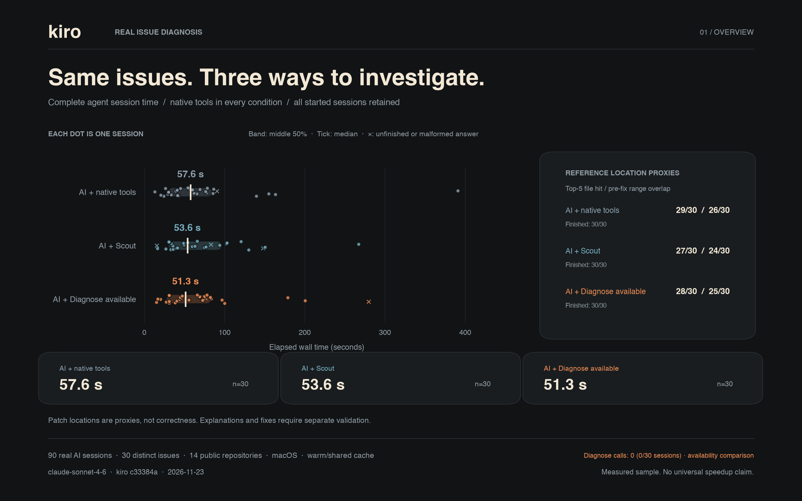
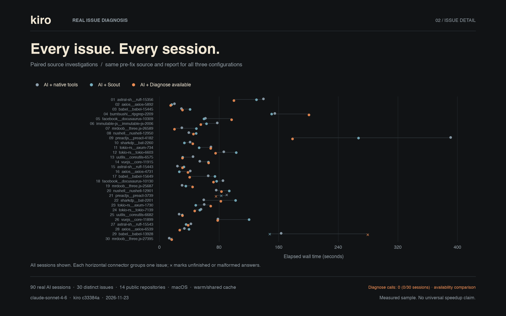
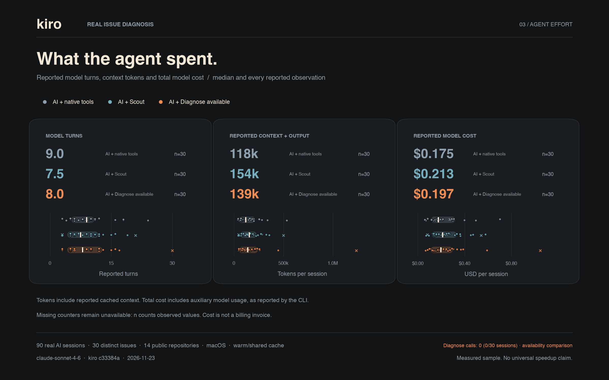
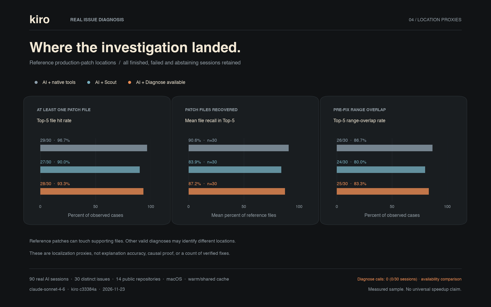

# Diagnose prototype — real AI comparison, 23 November 2026

This experiment compares native tools, the existing Scout configuration and the new
experimental diagnose pipeline. It uses 30 distinct public issues from 14 repositories,
14 Rust and 16 JavaScript/TypeScript cases, selected before model measurements.

**The experiment is complete: 90/90 sessions finished, with all condition-specific tools
verified and unchanged source/reference data.** Source: `c33384ace0e70394bc1e3387b158f128cdf4bf83`.

**The new diagnose tool was called in 0/30 sessions where it was available.** Those sessions
used native tools and/or existing Scout/run instead. This is an availability comparison,
not a measurement of the new pipeline's speed or effectiveness.

| Configuration (30 sessions each) | Median wall time | Median model turns | Total reported cost | Parsed answers | Top-5 reference-file hit | Reference-region overlap |
| --- | ---: | ---: | ---: | ---: | ---: | ---: |
| AI + native tools | 57.56 s | 9 | $6.6211 | 29/30 | 29/30 | 26/30 |
| AI + Scout | 53.60 s | 7.5 | $7.2817 | 27/30 | 27/30 | 24/30 |
| AI + Diagnose available | 51.31 s | 8 | $7.1994 | 28/30 | 28/30 | 25/30 |

The ratio of condition medians suggests 6.9% less time with Scout and 10.9% with Diagnose
available. That is different from comparing each issue to itself: **the median paired
time ratio is 0.9710 for Scout and 0.9949 for Diagnose available**, corresponding to 2.9%
and 0.5% less time respectively. Each configuration was faster than native tools on
16/30 cases. The per-issue chart preserves the large outliers. None of these descriptive
figures proves a causal speedup with one session per cell.

Total reported cost rose by 10.0% with Scout and 8.7% with Diagnose available. The measured
campaign cost $21.1023, including reported auxiliary `claude-haiku-4-5-20251001` usage.
The primary model was `claude-sonnet-4-6` in all 90 sessions. Four excluded synthetic
preflight/smoke sessions cost a further reported $0.3768; they do not enter the charts.

Six answers could not be parsed by the frozen parser: one native, three Scout and two
Diagnose-available answers. They keep their measured time/cost and receive no location
credit. All successfully parsed answers hit at least one reference file; this does not
establish a correct explanation. Invalid or missing source ranges are excluded separately.
One Scout call omitted required terms and returned an error; the session is retained.
No CLI permission denials were reported.

Kiro tools were actually used in 29/30 Scout sessions and 29/30 Diagnose-available sessions.
Scout was called 41 and 42 times respectively; run was called 23 and 10 times. Native
Read/Grep/Glob remained heavily used. Diagnose had zero measured calls, despite a successful
forced-call preflight. A source-supported local pipeline therefore still needs an effective
agent/harness integration before an end-to-end benefit can be claimed.









### Explanation review

All 90 answers received source-based AI-assisted review with configuration names hidden.
The 374 cited evidence ranges were checked against the supplied sources.

| Configuration | Supported | Mixed | Insufficient |
| --- | ---: | ---: | ---: |
| AI + native tools | 27 | 3 | 0 |
| AI + Scout | 26 | 4 | 0 |
| AI + Diagnose available | 26 | 4 | 0 |

These are qualitative labels from AI reviewers, not human-certified accuracy. Reviewers
were familiar with implementation/data preparation; there is one reviewer per case.
A supported main explanation can still contain peripheral errors or unvalidated suggestions.
The full [answer review](answer-review.json), [review method](review-method.json) and
[fixed rubric](review-rubric.json) preserve evidence and uncertainty. No better explanation
quality is established for either added-tool configuration.

Concrete material issues included a Babel explanation assuming shared key/value nodes despite
`cloneIdentifier`, an incomplete cksum fix leaving `std::env::args()` on the non-UTF-8 path,
and an Axum explanation confusing a compile-time trait bound with runtime state loss.
Conversely, malformed JSON can contain a supported explanation: parser compliance, patch-file
coverage, range accuracy and causal reasoning are different properties.

The prototype passes its implementation checks, but this campaign does **not** establish
a compelling practical advantage over native tools or evaluate the unused diagnose pipeline.
An explicit integration on real CI failure reports, followed by test-validated diagnosis/repair
evaluation, remains a separate experiment. The local specialist model is not integrated.

### Verification and artifacts

- [All measurements and redacted answers](results.json), [CSV](results.csv), [derived summary](summary.json)
- [Frozen protocol](protocol.json), [post-measurement presentation correction](presentation.json), [reference-location annotations](gold.json), [private-trace hashes](private-trace-hashes.json)
- [Implementation checks and retained CI failure](verification.json)

Local checks passed: format, Clippy on Rust 1.93.1 and 1.99.0, 179 all-target tests, doctests,
release build, 15/15 exact native/MCP fixture cases and 16 benchmark helper checks.
The [first CI run](https://github.com/nicolashedoire/kiro/actions/runs/45226289473) failed
with Git discovery timeouts under parallel tests. A workflow-only change serialized the
tests, preserving assertions and production limits. The [subsequent Rust 1.100 CI](https://github.com/nicolashedoire/kiro/actions/runs/45226808308)
passed all 179 tests, format, Clippy and replay. Source and measured binary did not change.

An audit of all 32 observed Bash commands found read/list/filter operations and no project
execution, dependency installation or network command. One Scout session read its own
current tool-result spill file outside the project root; this was the current source-derived
response, not another session or a reference answer. Raw traces remain private.


## What is measured

Each case is investigated once in each of three fresh Claude Code sessions (90 measured
sessions), with primary model `claude-sonnet-4-6`, effort medium. Native Bash, Read, Grep
and Glob are available in every configuration; batching, scripts and filtering are allowed.
Scout adds Kiro MCP run/scout. Diagnose adds the same tools plus diagnose. The same binary
serves both MCP conditions with an explicit tool allowlist; disabled tools are not advertised
and cannot be called. Tool availability is checked at initialization and uses are recorded.

The experiment measures full-process wall time, including CLI/MCP startup, model requests,
tools and final output. CLI/API-reported durations are retained separately. Missing counters
remain null. Reported cost is not an invoice; tokens include the CLI's reported cache counters.
All started sessions remain in the data, including slow, unsuccessful and malformed answers.
No session is selectively rerun. The per-session limits are 480 seconds and $3 of reported
model cost, with at most four sessions running concurrently.

Task order is deterministically shuffled. The configuration order rotates across cases,
with ten cases in each starting position. Conversations are fresh, CLI setting sources
are disabled and unrelated tools, agents and Chrome are unavailable. MCP startup is eager.
Filesystem caches are shared/warm; provider prompt caching is enabled. Background activity
on this single Mac is not fully controlled. These are paired descriptive observations,
with one repetition per case/configuration, not a statistical significance claim.

## Source data and isolation

The cases come from [SWE-bench Multilingual](https://www.swebench.com/multilingual.html),
with [the dataset card](https://huggingface.co/datasets/SWE-bench/SWE-bench_Multilingual)
reporting an MIT license. The pinned task repository and archive hash are recorded in
[selection-protocol.json](selection-protocol.json). The original dataset tests repairs;
this experiment uses its issue descriptions and pre-fix source for read-only diagnosis.
Some selected issues request changes to API behavior, so these are 30 investigation cases,
not a claim that every case is a conventional bug.

Each configuration receives the same pinned production-only source projection for a case:
Rust/JavaScript/TypeScript files and package metadata, excluding separate test, documentation,
fixture, dependency and build trees. Original source bytes, comments and inline tests remain.
No projects or dependency installers are executed. The 30 projections contain 15,287 files
and 94,007,369 source bytes in total; [the manifest](manifest.json) records every file and
source commit. The largest files may encounter the tools' normal exclusions or resource
bounds; no projection was trimmed based on prototype results.

OS policy denies project writes, reads of reference patches/other answers, and reads of
other case projections. The policy also protects reference data and other projections
from blind writes. Each session can read its own MCP configuration. Before/after fingerprints
cover relative file names, kinds, permission modes and contents. Raw traces remain private
because CLI initialization contains local machine/account context. Published answers replace
project/home paths with placeholders.

The [selection protocol](selection-protocol.json), [case IDs](selected-case-ids.json),
[prompts](tasks.json) and [qualitative rubric](review-rubric.json) were fixed before the
measured campaign. Reference patches, added tests, hints and FAIL_TO_PASS identifiers are
not sent to the model. Gold annotations are OS-denied during the runs and may be published
with the completed results for inspection. Public benchmark material may overlap with model
training data; this experiment cannot eliminate that possibility.

## What the quality metrics mean

The model returns ranked production files, source line ranges of at most 40 lines and an
explanation. The frozen parser accepts a JSON object alone or extracted from surrounding
prose/code fences; it does not grade strict JSON-only presentation. Invalid JSON is not repaired. Top-5 uses the first five distinct paths. File-hit rate means at least one of
those paths is a production file modified by the reference patch; file recall measures the
share of reference files recovered. Region overlap means a narrow, valid pre-fix range
intersects a reference region in a Top-5 file. Invalid, missing or out-of-file ranges receive
no region credit. Failed/unparseable sessions remain in the denominators.

Reference locations are an imperfect proxy: alternative diagnoses can be valid, and a
correct path or overlapping range does not establish a correct explanation. Pure insertions
use explicit nearby pre-fix anchor lines. The preparation checks validate 107 reference
regions, including 29 insertion contexts, against the pre-fix sources.

A separate AI-assisted source review evaluates all explanations using the predeclared rubric.
Review inputs hide configuration names; self-references in answers may reveal them. Labels
are qualitative, not human-certified accuracy scores. No external project test suite was
run and no fix was validated. These results must not be presented as SWE-bench resolution
rates, causal proof, or production repair reliability.

## Artifacts and reproduction

- [Runner](run_sessions.py), [pure helper checks](verify_helpers.py)
- [Dataset preparer](prepare_dataset.py), [preparation checks](preparation-checks.json)
- [Chart renderer](render_charts.py), [plot dependencies](requirements.txt)
- [Prototype usage, contracts and limits](../../diagnose.md)

Build the exact source commit recorded in protocol.json, then run prepare_dataset.py in a
new disposable directory. Keep its private reference data outside the model-visible source
roots. The preparer downloads pinned upstream sources; it never runs project code.

```sh
# Source used by all measured configurations.
git checkout c33384ace0e70394bc1e3387b158f128cdf4bf83
cargo build --locked --release

# Keep the harness/results from the publication revision separately when checking out source.
python3 /path/to/published-harness/prepare_dataset.py --root /tmp/kiro-diagnose-data --count 30

# Real paid model sessions; requires Claude Code authentication and macOS sandbox-exec.
python3 /path/to/published-harness/run_sessions.py \
  --tasks /tmp/kiro-diagnose-data/tasks.json \
  --projects-json /tmp/kiro-diagnose-data/projects.json \
  --gold /tmp/kiro-diagnose-data/private/gold.json \
  --binary target/release/kiro --output /tmp/kiro-diagnose-runs \
  --kiro-commit c33384ace0e70394bc1e3387b158f128cdf4bf83 \
  --date 2026-11-23 --model claude-sonnet-4-6 --repetitions 1 \
  --max-parallel 4 --timeout-seconds 480 --max-budget-usd 3 \
  --deny-read /path/to/published-harness

# Plot published measurements without making any model calls.
python3 -m venv /tmp/kiro-plot-venv
/tmp/kiro-plot-venv/bin/pip install -r requirements.txt
/tmp/kiro-plot-venv/bin/python render_charts.py \
  --input results.json --output-dir /tmp/kiro-diagnose-charts
python3 summarize_results.py --input results.json --reviews answer-review.json --output /tmp/kiro-summary.json
python3 verify_helpers.py
```

The earlier [30-session Scout experiment](../2026-11-23-sonnet46/README.md) uses three tasks
and a Bash-only baseline, while this experiment uses 30 external cases and native reading
and search tools. The campaigns are separate; their aggregate percentages do not isolate
a version-to-version speed or quality change.
