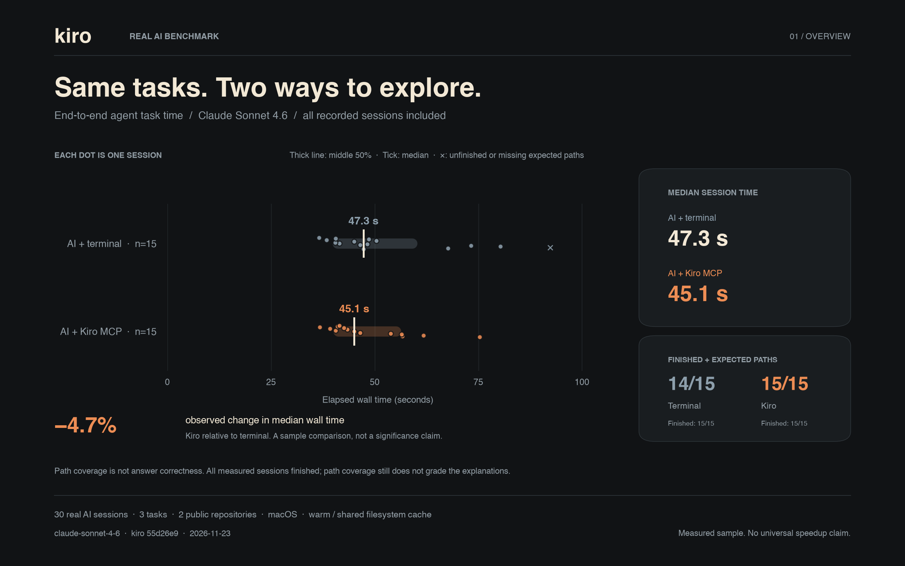
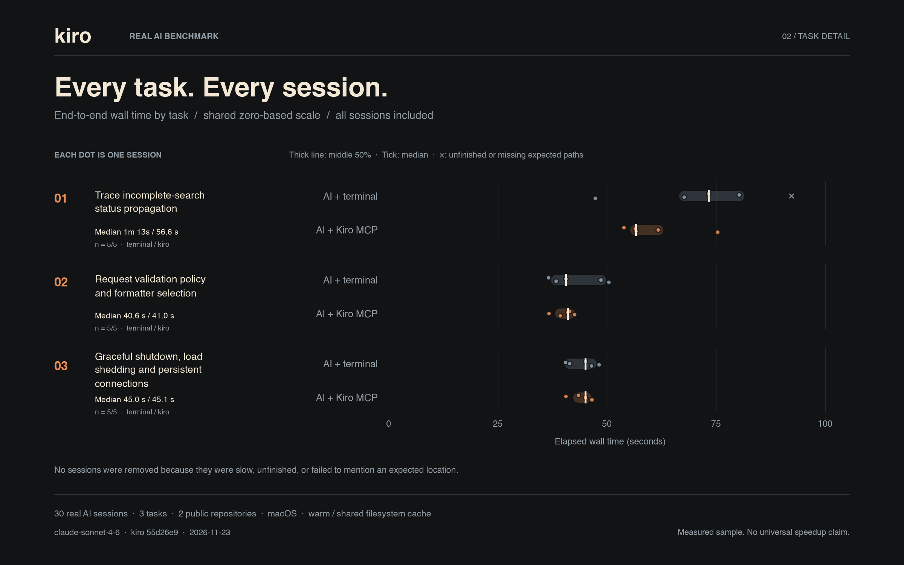
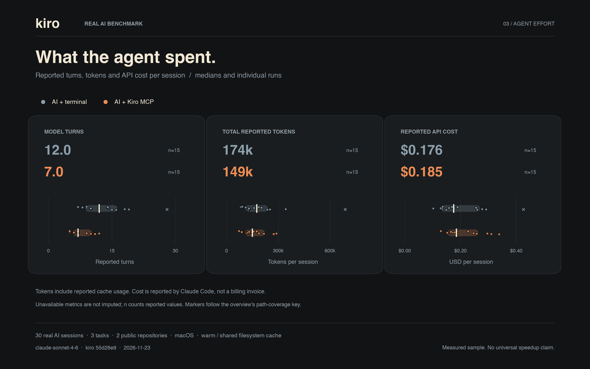

# Real AI sessions — 23 November 2026

This experiment tests Kiro source
[`55d26e9`](https://github.com/nicolashedoire/kiro/commit/55d26e934589e7c15d69c882d5f956493878dca5),
including structured results, Tree-sitter context and the subsequent Scout fixes.
The experiment ran **30 fresh Claude Code sessions**: three tasks, five
repetitions and two configurations, using `claude-sonnet-4-6` at effort `medium`.

## Observed results

All 30 measured sessions finished successfully; all returned parseable JSON. Kiro's
server was connected and both tools were available at initialization in all 15 Kiro
sessions. No session hit the timeout or cost cap, no permission denial was reported, and
the source fingerprints were unchanged. Every started session is included.



| Metric, 15 sessions per configuration | AI + terminal | AI + Kiro MCP |
| --- | ---: | ---: |
| Median full-session wall time | 47.28 s | 45.06 s |
| Mean full-session wall time | 53.13 s | 48.38 s |
| Median reported model turns | 12 | 7 |
| Median reported tokens, including cached context | 174,482 | 148,946 |
| Median reported model cost | $0.17555 | $0.18506 |
| Total reported model cost | $3.02740 | $3.16967 |
| Technically finished sessions | 15/15 | 15/15 |
| Finished with every required path | 14/15 | 15/15 |

The pooled median was **4.7% lower with Kiro**. Median turns were 41.7% lower, but the
reported cost total was 4.7% higher. Those are descriptive sample differences, not
significance claims. Fewer turns and fewer cached-context tokens do not imply lower cost:
input, cached input and generated output have different billing weights.

| Task, five sessions per configuration | Terminal median | Kiro median | Kiro time change |
| --- | ---: | ---: | ---: |
| Kiro incomplete-search status | 73.26 s | 56.65 s | −22.7% |
| Fastify validation flow | 40.57 s | 41.03 s | +1.1% |
| Fastify shutdown/draining | 45.02 s | 45.06 s | +0.1% |

The clearest observed time difference is on the small Kiro self-test. The two Fastify
tasks have similar median times. This sample does not support a broad latency or answer
quality improvement claim for external projects.





The terminal configuration made 184 Bash calls. Kiro sessions made 88 `run`, nine `scout`
and five Bash calls; `scout` was used in nine of 15 sessions. All five Bash fallbacks were
file-discovery commands on Kiro. This compares complete tool configurations and does not
isolate Tree-sitter's contribution.

Nine Kiro tool results carried the tool-error flag. Their CLI traces expose text without
the trusted structured transport field, so the affected per-session refusal totals remain
`null` (nine sessions). The other six sessions have observable zero refusals. Unknown
counts are not treated as zero; tool errors and recovery time remain in the timings.

All 406 observable assistant messages identify `claude-sonnet-4-6`. The CLI also reports
auxiliary `claude-haiku-4-5-20251001` usage in every session. The plotted token totals sum
the top-level CLI usage fields (equal to the Sonnet counters here); reported total cost
includes auxiliary usage, $0.02577 across the campaign. The measured campaign cost is
**$6.19707**, excluding the preliminary checks. It is CLI-reported cost, not an invoice.

### Source-based review of explanations

All 30 final answers were reviewed by AI reviewers against the pinned source, using the
predeclared rubric, with reconciliation of material issues. This is not a blinded review
or a human-certified correctness assessment. Labels concern the requested behavior;
`consistent` does not certify every statement or exact line reference.

| Qualitative label | Terminal | Kiro |
| --- | ---: | ---: |
| No material contradiction identified (`consistent`) | 7 | 4 |
| Flow mostly explained, with an error/important omission (`mixed`) | 7 | 11 |
| Requested responsibility substantially misdescribed (`insufficient`) | 1 | 0 |

Both configurations made concrete explanation errors. Examples include unguarded claims
about Fastify's idle-connection closing, an invented formatter arity/return-value contract,
and confusion between Kiro's internal `is_error` field and MCP's wire key `isError`. The
one terminal answer missing a required path also materially misdescribed Scout's CLI
status propagation. Kiro's 15/15 path coverage is therefore **not** 15 correct answers.
[The individual reviews](answer-review.json) retain the evidence and qualifications;
[descriptive aggregates](summary.json) can be checked against the measurements.

## What the comparison measures

- **AI + terminal:** Claude Code with its built-in `Bash` tool only, executing real system
  commands. Independent reads and searches may be batched.
- **AI + Kiro MCP:** the same model, task prompt and Bash tool, plus Kiro's `run` and
  `scout`. Bash fallback is allowed. The configuration includes Kiro's tool descriptions,
  server instructions, structured results and context selection.
- Built-in Read/Grep/Glob, editing tools, other agents, slash commands, Chrome and unrelated
  MCP servers are unavailable. The baseline does not represent a harness with optimized
  native file-reading tools; this limitation matters when interpreting the result.
- Timing uses a monotonic clock around the full CLI process, including startup, MCP,
  model requests, tools and final output. CLI-reported and API-reported durations are
  retained separately and are not substituted for wall time.
- Conversations are fresh (`--no-session-persistence`); user/project settings sources are
  disabled. Provider prompt caching is not disabled. Filesystem caches are warm/shared.
- Setup order alternates across repetitions and task order is shuffled with a fixed seed.
  Up to four sessions run concurrently. Per-session UTC timestamps and schedule indices
  are published, so overlap can be inspected.
- Every started measured session is retained, including errors, timeouts, invalid answers
  and missing expected locations. There is no selective rerun. Limits are 480 seconds and
  $3 of reported model cost per session.
- macOS `sandbox-exec` denies writes to each source projection. The write denial was
  checked before measurements. Before/after fingerprints include paths, kinds, modes and
  bytes. This protects the tested project trees, not the entire machine.

## MCP readiness

Preliminary tool checks found that this CLI could report Kiro as `pending` at the first
turn, leaving the model with Bash alone. Those checks were excluded before starting the
fixed experiment. The measured configuration therefore sets `alwaysLoad: true` for Kiro
and uses `MCP_CONNECTION_NONBLOCKING=0` and `ENABLE_TOOL_SEARCH=false` in **both** conditions.
The clock still includes startup waiting. These settings are described in the
[Claude Code MCP documentation](https://code.claude.com/docs/en/mcp#exempt-a-server-from-deferral).

The runner records initial tool names and server status for every session; availability
is checked independently of whether the model chooses to use Kiro. Unavailable tools
cannot silently be presented as a Kiro treatment. This is another protocol difference
from the earlier experiment.

## Pinned production-only datasets

The same projection is used by both configurations:

- **Kiro:** `55d26e934589e7c15d69c882d5f956493878dca5`, ten Rust files under `src/`,
  `Cargo.toml` and `Cargo.lock`: 12 files.
- **Fastify:** `6de5abedb24424f0e8fa3612035d212d580f8d90`, `fastify.js`, JavaScript files
  under `lib/` and `package.json`: 32 production JavaScript files plus the manifest.
- No separate `.git`, README, documentation, test, example, dependency, benchmark or build
  trees are included. Source bytes are preserved: inline comments and Rust `#[cfg(test)]`
  modules remain in their production files. Dependencies are not installed and project
  code is not executed. Preparation normalizes file permissions to the measured `0644`.

The current Kiro repository contains published task prompts and answers from the previous
benchmark. Removing them avoids answer contamination. It also changes the dataset scope:
**results from 21 and 23 November are separate experiments, not a causal estimate of the
speed or quality gained from Tree-sitter or a version upgrade.** The comparison within
this experiment uses the same inputs for both configurations.

[Task prompts and expected paths](tasks.json) and the [review rubric](review-rubric.json)
were fixed before the measured sessions. Expected paths and ground-truth notes are not
sent to the model. [The dataset manifest](datasets.json) records every included file,
size, hash and source commit. [The protocol record](protocol.json) records the executed
runner, task and binary fingerprints and the machine/software environment.

## Quality and interpretation

Required-path coverage means a technically finished session returned valid parsed JSON
containing every expected production path. Extra files are not penalized. This does not
grade explanations, line references, defaults, proposed changes or semantic correctness.
All final answers are reviewed against the source using the predeclared rubric. That
review is qualitative and not blinded; it is published separately from the coverage
metric and should not be interpreted as a statistical correctness score.

This is a single-machine, single-model, three-task source-investigation experiment. It
measures neither editing, tests, builds nor general terminal compatibility. Kiro itself
is a small self-test; Fastify is the external project. Provider latency, cache behavior,
concurrency and stochastic tool choices can change the results. An additional baseline
with native Read/Grep tools and a larger task sample would improve external validity.

## Data and reproduction

- [Per-session measurements and final answers](results.json)
- [Numeric measurements, CSV](results.csv)
- [Descriptive aggregates](summary.json)
- [Qualitative answer review](answer-review.json)
- [Session runner](run_sessions.py), [dataset preparation](prepare_datasets.py)
- [Chart renderer](render_charts.py) and [plotting dependencies](requirements.txt)

Raw CLI traces stay private because initialization contains local machine/account context.
Published answers and errors replace project/home paths with placeholders. The measured
answers are retained even when incomplete or incorrect. Setup/smoke calls live separately
and are not part of the 30-session dataset.

Prepare trusted checkouts at the pinned commits, build Kiro at `55d26e9`, then create the projections
outside those checkouts:

```sh
# In a disposable Kiro checkout:
git -C /path/to/kiro checkout 55d26e934589e7c15d69c882d5f956493878dca5
cargo build --locked --release --manifest-path /path/to/kiro/Cargo.toml
python3 prepare_datasets.py \
  --kiro-checkout /path/to/kiro --fastify-checkout /path/to/fastify \
  --output /path/to/disposable-datasets --manifest datasets.json

# Makes real model calls; requires an authenticated Claude Code CLI and macOS.
python3 run_sessions.py --tasks tasks.json \
  --project kiro=/path/to/disposable-datasets/kiro \
  --project fastify=/path/to/disposable-datasets/fastify \
  --binary /path/to/kiro/target/release/kiro \
  --kiro-commit 55d26e934589e7c15d69c882d5f956493878dca5 \
  --date 2026-11-23 --output /path/to/empty-private-results \
  --model claude-sonnet-4-6 --repetitions 5 --max-parallel 4

python3 -m venv plot-venv
plot-venv/bin/python -m pip install -r requirements.txt
plot-venv/bin/python render_charts.py \
  --input /path/to/empty-private-results/results.json --output-dir figures
```

A rerun has different provider/cache state and model outputs. The historical experiment
remains available in [the 21 November archive](../2026-11-21-sonnet46/README.md).
